# T3 Deck

**Real-time [T3 Code](https://github.com/pingdotgg/t3code) mission control for Elgato Stream Deck.**

[](https://github.com/charlesbine/t3-deck/actions/workflows/ci.yml)
[](#whats-new-in-v12--multi-device-support)
[](LICENSE)
[](#supported-elgato-devices)

T3 Deck connects directly to your local T3 Code server over its native **Orchestration V2 WebSocket RPC** stream — zero extra daemon, zero polling, and sub-50ms live updates across every provider you run in T3 Code (Claude, Codex, Antigravity, OpenCode, and more).

Approve or inspect multi-subagent shell commands without turning back to your monitor, answer agent questions right on the LCD touch strip, dial in a new repo/model/worktree chat with all four knobs, switch models and reasoning effort on the fly, and keep live provider quota bars in view at all times.

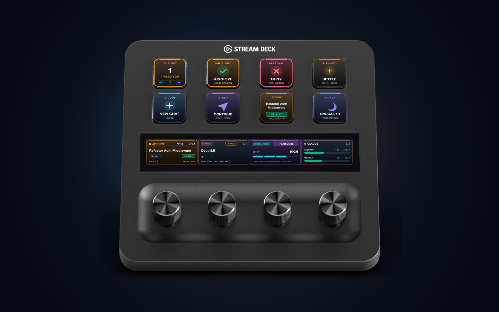

---

## Interactive Flow Overview

Hold any contextual key — or tap **`APPROVE?`** when agents are waiting — and T3 Deck seamlessly transforms all 8 LCD keys and turns the 4 flush dials into a single **`1600×200` panoramic touch strip**:

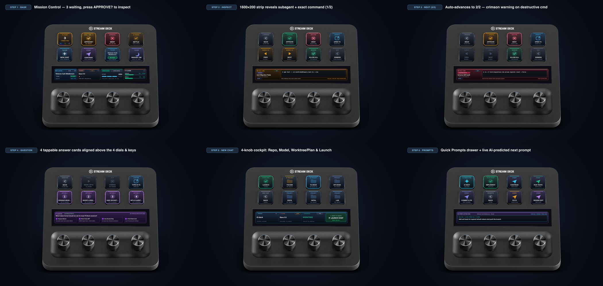

---

## What's New in v1.2 — Multi-Device Support

T3 Deck now adapts automatically to **every Elgato Stream Deck** — reading each connected device's exact key grid (`device.size`) and encoder strip (`device.type`) at runtime, with **independent per-device overlays** if you run more than one deck at your desk.

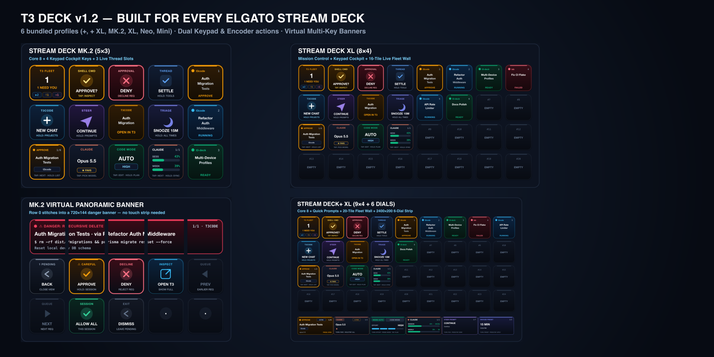

### Supported Elgato Devices

| Device | Grid & Controls | Bundled Profile | Overlay & Strip Behavior |
|---|---|---|---|
| **Stream Deck+** | `4×2` keys + 4 dials (`1600×200` strip) | `T3 Deck` | Full `1600×200` panoramic touch strip + 4-knob New Chat cockpit |
| **Stream Deck+ XL** | `9×4` keys + 6 dials (`2400×200` strip) | `T3 Deck (+ XL)` | Extended `2400×200` 6-dial strip (Dials 5 & 6 = Prompt & Snooze scrubbers) + 20-tile Live Fleet Wall |
| **Stream Deck MK.2 / Classic** | `5×3` keys (15) | `T3 Deck (MK.2)` | Core 8 + 4 Keypad Cockpit keys + 3 Thread Slots; **Row 0 stitches into a `720×144` Virtual Panoramic Banner** during approvals, questions & prompts |
| **Stream Deck XL** | `8×4` keys (32) | `T3 Deck (XL)` | Mission Control + 4 Cockpit keys + 4 Quick Prompts + 16-tile Live Fleet Wall; **Row 0 stitches into an `1152×144` Virtual Panoramic Banner** |
| **Stream Deck Neo** | `4×2` keys (8, 2 pages) | `T3 Deck (Neo)` | Page 1 Triage & Control + Page 2 Keypad Cockpit & 4 Thread Slots (via Neo's built-in page touch points); compact inline inspect tile |
| **Stream Deck Mini** | `3×2` keys (6, 2 pages) | `T3 Deck (Mini)` | Page 1 Triage + Thread/Model/Mode + Page 2 New Chat/Prompt/Settle/Open/Snooze/Usage; compact 6-key approval/question views |
| **Mobile / Virtual / Studio / Galleon** | Dynamic (`device.size`) | Drag from sidebar | Automatically adapts grid pagination, `originSlot` `BACK` placement, and Virtual Banners |

- **Dual-Controller Actions (`Keypad` + `Encoder`):** `Thread Navigator`, `Model & Provider`, `Mode & Effort`, `Usage Radar`, `Send / Steer Prompt`, and `Snooze / Sync` work seamlessly on **both** LCD keys and rotary dials.
- **Keypad-Native Pickers:** Tapping **Model & Provider** on a keypad-only deck opens a full-grid **Model Picker** (`★ FAVS ↔ ALL` + 1-tap apply); tapping **Mode & Effort** opens a 1-tap **Permission + Plan/Code + Reasoning Effort** grid.
- **Auto-Numbered Fleet Walls:** Placing multiple **Thread Slot** keys on any device automatically numbers them `#1..#N` in reading order — zero manual slot index config.

---

## Highlights & Interactive Flows

- **Panoramic `1600×200` Touch-Strip Takeovers** — All 4 flush dial canvases combine into a continuous widescreen display for inspecting commands, reading questions, scrubbing snooze durations, previewing prompts, and building new chats.
- **2-Step Safe Approval Inspector + Multi-Subagent Queue** — Never approve blind. Tapping `APPROVE?` reveals *which* thread or subagent is asking, its parent thread, and the exact shell command or file path — with an automatic **crimson danger alert** for destructive patterns (`rm -rf`, `git push --force`, `reset --hard`, `DROP TABLE`, etc.). Approving or denying automatically slides the next queued request (`1/2 → 2/2`) into view.
- **Panoramic Question Responder** — Agent multiple-choice prompts render as 4 tappable answer cards aligned directly above the 4 dials and underneath Keys 5–8 (supports single-select instant submit, multi-select toggle + submit, pagination, and dismiss).
- **4-Knob Cockpit New Chat Builder** — Hold **New Chat** to turn the whole deck into a hardware chat launcher: **Dial 1** picks Project, **Dial 2** picks Model (tap for `★ FAVS ↔ ALL`), **Dial 3** picks `LOCAL / WORKTREE / SCRATCH` (tap for `CODE ↔ PLAN`), and **Dial 4** launches the chat. Configurable via Property Inspector.
- **Dynamic 8-Preset T3 Snooze Sync** — Mirrors your exact `settings.snoozePresets` from T3 Code: preset `#1` sits on short tap (`15M`), presets `#2–#8` fill the hold drawer, **Dial 1** scrubs custom durations (`15m → 24h`), and Dial 1 shows `SNOOZED · <ETA>` whenever the focused thread is snoozed.
- **Quick Prompts Drawer + Live AI-Predicted Next Prompt** — Hold **Continue** to pull in T3 Code's live `subscribePromptSuggestion` (`✨ AI NEXT`) alongside one-tap presets (`IMPLEMENT`, `TESTS`, `COMMIT`, `REVIEW`, `DIFF`, `FIX CI`).
- **Resilient Quota Radar** — Surfaces `⚠ SIGN-IN EXPIRED` / `probeFailed` warnings (with `PRESS DIAL TO REFRESH`) instead of silently dropping providers when an OAuth session expires.
- **Consistent Muscle Memory** — Every hold submenu places **`BACK` on the exact physical key you held** (`originSlot`), and consumes the key-up event so releasing a hold never accidentally triggers a submenu button.

---

## Visual Tour

### 1. Base Mission Control

Your default view tracks whichever thread you currently have open in T3 Code (`lastVisitedAt` / `opens.openedAt`). Click a thread in T3 Code and the deck follows instantly; twist Dial 1 to scrub threads across all projects.

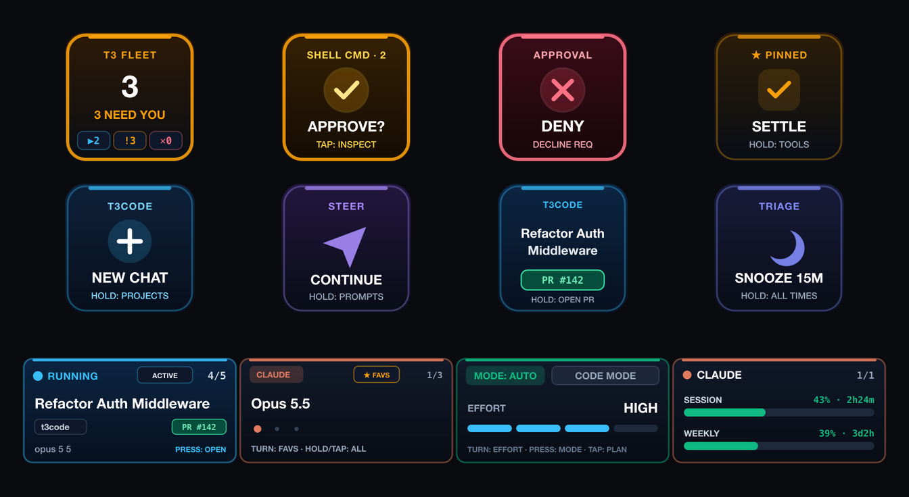

---

### 2. 2-Step Safe Approval Inspector (Multi-Subagent Queue)

When one or more subagents request permission, Key 2 pulses **`APPROVE?`** with the live pending count (`2 REQ`).

1. **Tap `APPROVE?` once** to open the panoramic inspector — showing the subagent name, parent thread, and exact command. **`CONFIRM`** stays on Key 2 so a safe command is a quick double-tap with zero finger movement.
2. **Approve or Deny** to auto-advance straight to the next waiting subagent (`2/2`). Destructive commands immediately switch the entire touch strip to a **crimson danger banner** (`⚠ DANGER: DESTRUCTIVE RM`) so you catch risky operations before your thumb hits confirm.

| Step 1 — Inspecting `1/2` (Safe Test Command) | Step 2 — Auto-Advanced `2/2` (Destructive Command Alert) |
|---|---|
| 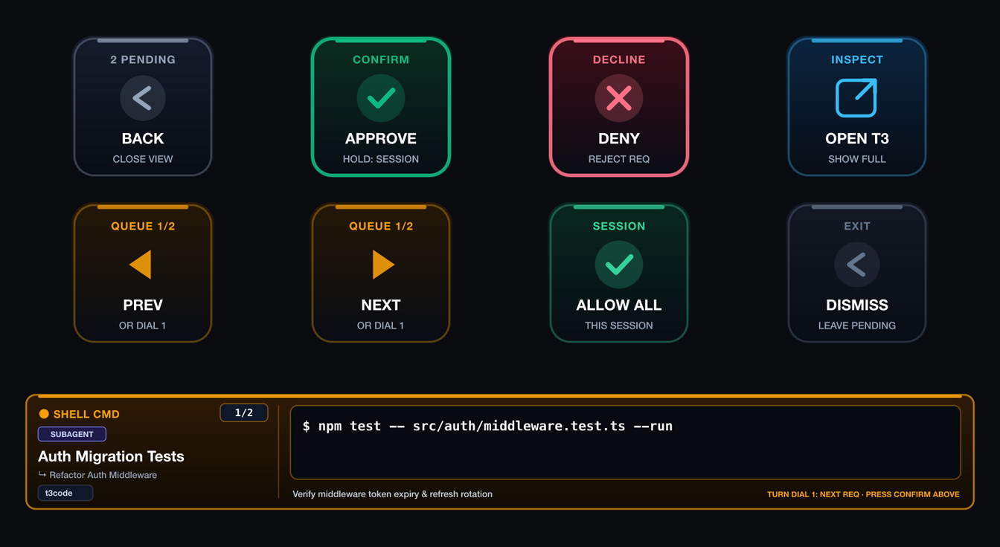 | 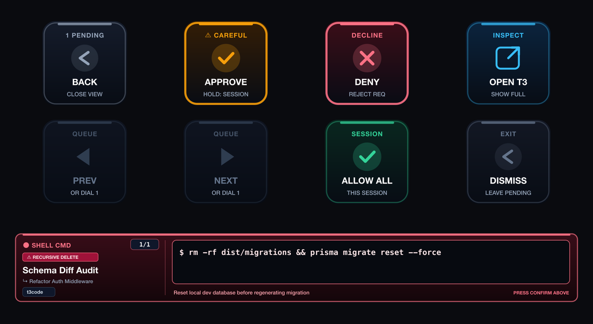 |

---

### 3. Panoramic Question Responder

When an agent asks a structured question (`user_input`), the touch strip displays the full question across the top and aligns **4 tappable option cards** directly over the 4 dials and below Keys 5–8. Tap the touch strip, press a dial, or hit the matching key below to answer — or hit **`TYPE IN T3`** to jump straight to the desktop composer.

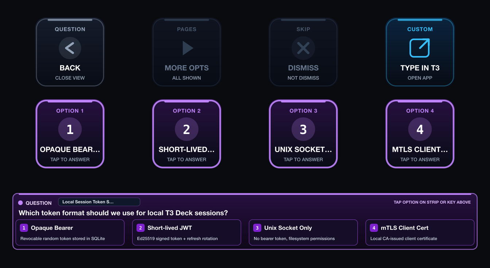

---

### 4. 4-Knob Cockpit New Chat Builder

Short-press **New Chat** (Key 5) to immediately create and open a fresh thread in your active project. **Hold Key 5** to open the 4-knob launcher:

- **Dial 1:** Scrub repositories (`t3code`, `t3-deck`, `lab`, …)
- **Dial 2:** Scrub models; tap/press to toggle **`★ FAVS ↔ ALL`**
- **Dial 3:** Scrub workspace mode (**`LOCAL`** / **`WORKTREE`** / **`SCRATCH`**); tap/press to toggle **`CODE ↔ PLAN`**
- **Dial 4:** Press or tap **`▶ LAUNCH CHAT`** (or tap Key 1 **`LAUNCH`**)
- **Keys 2–4 & 6–8:** Quick-pick keys (configurable in Property Inspector to show Projects, Environments, or Models first)

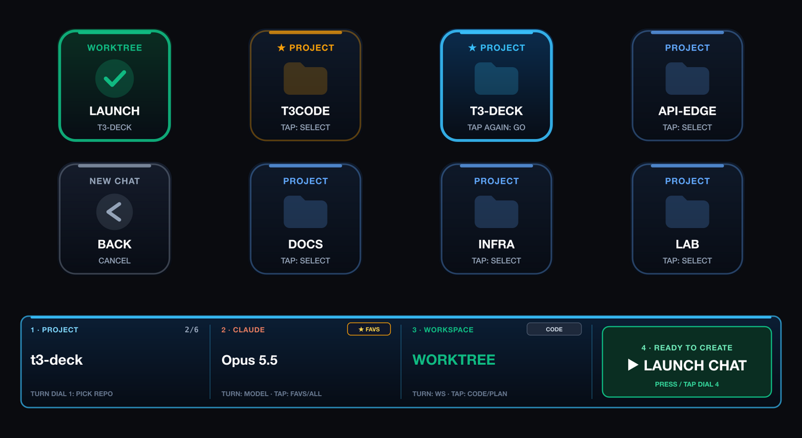

---

### 5. Dynamic 8-Preset Snooze + Custom Scrubber

T3 Deck reads your live `settings.snoozePresets` directly from T3 Code (up to 8 presets):
- **Short-press Key 8:** Snooze immediately with preset `#1` (e.g. `15M`), or unsnooze if already snoozed.
- **Hold Key 8:** Opens presets `#2–#8` across the other 7 keys (`BACK` stays under Key 8), while **Dial 1** scrubs any custom duration (`15m → 24h`) and taps to apply.

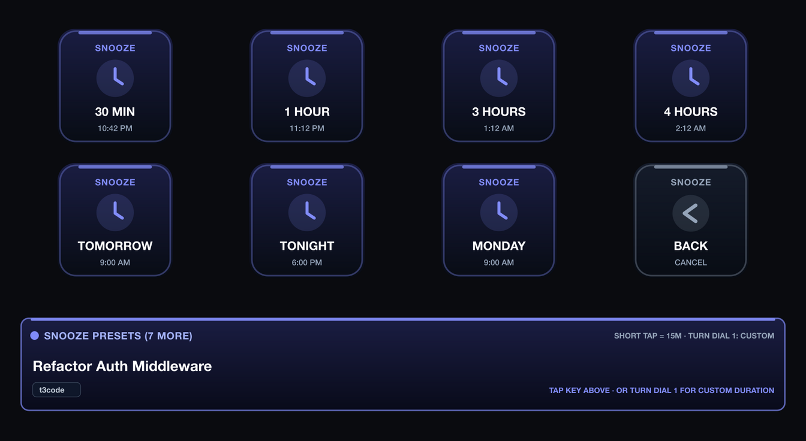

---

### 6. Quick Prompts Drawer + Live `AI NEXT`

Short-press Key 6 to send or steer your configured quick prompt (default: **`CONTINUE`**). **Hold Key 6** to open the Quick Prompts drawer:
- **`AI NEXT`** streams T3 Code's live predicted follow-up prompt (`orchestration.subscribePromptSuggestion`) onto the panoramic strip so you can read it before sending.
- **`IMPLEMENT`** triggers plan execution (`hasActionableProposedPlan` lights up green when a plan is ready).
- Turn **Dial 1** to preview any prompt on the strip and tap to send.

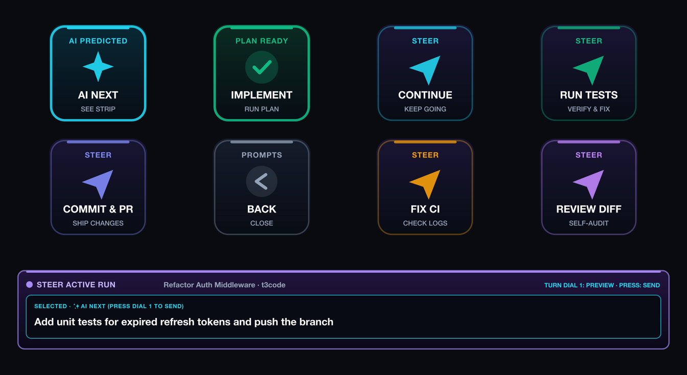

---

## Mission Control Reference

### Base Layer — Keys (4×2)

| Key | Action | What it shows | Short Press | Hold (650ms) |
|---|---|---|---|---|
| **1** (`0,0`) | **Fleet Pulse** | Global counts (`▶ running`, `! needs you`, `✕ failed`) | Focus highest-priority thread (opens Approval/Question inspector if pending) | Open **Fleet Switchboard** (7 live thread tiles + pagination) |
| **2** (`1,0`) | **Approve / Answer** | Amber `APPROVE?` (+ queue count), purple `ANSWER` (`?`), or dim `NO PENDING` | Open **2-Step Approval Inspector** or **Question Responder** | Approve immediately for session (`acceptForSession`) |
| **3** (`2,0`) | **Stop / Deny** | Rose `DENY` on approval, red `STOP` when running, or dim `NOT RUNNING` | Decline approval (`decline`) or interrupt active run | Force-stop thread (`orchestration.forceStopThread`) |
| **4** (`3,0`) | **Settle / Pin** | Checkbox icon (`□✓`) + `SETTLE` / `UNSETTLE` + `★ PINNED` header | Toggle Settle / Unsettle | Open **Thread Tools** drawer (`Settle`, `Pin`, `Unread`, `Open PR`, `Stop`, `Snooze`, `Resync`) |
| **5** (`0,1`) | **New Chat** | `+` icon + active project name | Create & open new chat in active project | Open **4-Knob Cockpit New Chat Builder** |
| **6** (`1,1`) | **Send / Steer Prompt** | Cyan `SEND` or purple `STEER` + custom label (default `CONTINUE`) | Send or steer configured prompt | Open **Quick Prompts Drawer** (`AI NEXT`, `IMPLEMENT`, `TESTS`, `COMMIT`, `REVIEW`, `DIFF`, `FIX CI`) |
| **7** (`2,1`) | **Open Thread / PR** | Project name + 2-line title + green `PR #` badge when linked | Focus thread in T3 Code Desktop | Open linked Pull Request in browser |
| **8** (`3,1`) | **Snooze / Sync** | Default T3 preset (`15M`), `UNSNOOZE`, or `RECONNECT` | Snooze with default preset (or unsnooze) | Open **8-Preset Snooze Drawer** + custom dial scrubber |

> Also includes a standalone **Thread Slot** key action in the **T3 Deck** sidebar category if you want a dedicated page of direct thread tiles.

### Base Layer — Rotary Dials & Touch Strip

| Dial | Widget | Rotate | Press / Hold | Touch Strip Tap |
|---|---|---|---|---|
| **1** | **Thread Navigator** | Scrub threads in most-recently-visited order | **Press:** Open thread in T3 Code | Cycle filter (`ACTIVE` / `ATTENTION` / `RUNNING` / `PINNED` / `ALL`) |
| **2** | **Model & Provider** | Browse **★ Favs** (or **All** models) | **Press:** Apply when scrubbing, or toggle `★ FAVS ↔ ALL` when idle<br>**Hold:** Toggle `★ FAVS ↔ ALL` | Apply when scrubbing, or toggle `★ FAVS ↔ ALL` |
| **3** | **Mode & Effort** | Adjust reasoning effort (`Low` / `Med` / `High` / `Max`) | **Press:** Cycle runtime permissions (`ASK` / `EDITS` / `AUTO` / `FULL`) | Toggle **Plan / Code** mode |
| **4** | **Usage Radar** | Cycle connected providers / accounts | **Press:** Refresh live usage limits | Refresh live usage limits |

---

## How It Works Under the Hood

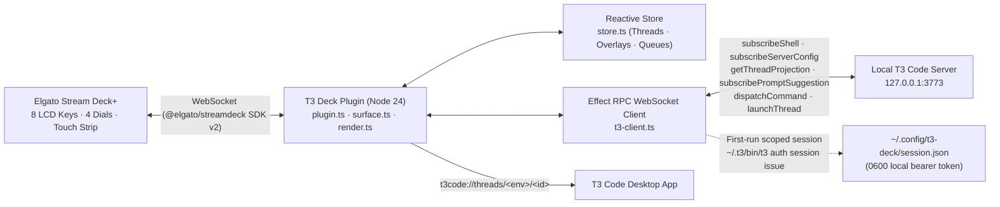

### Key Architectural Pieces

- **Zero-config discovery & scoped auth ([t3-client.ts](src/t3-client.ts)):** Discovers your local T3 Code server port from `~/.t3/userdata/server-runtime.json` (respecting `T3CODE_HOME`) and mints a scoped bearer token once via `t3 auth session issue --scope orchestration:read --scope orchestration:operate --ttl 365d`, stored locally with `0600` permissions at `~/.config/t3-deck/session.json`. You can inspect or revoke it anytime in T3 Code under **Settings → Sharing & access**.
- **Event-driven RPC streams — zero polling:** Subscribes to `orchestration.subscribeShell` and `server.subscribeServerConfig` over WebSocket. On-demand calls to `orchestration.getThreadProjection` fetch full command prompts, safety flags, and question schemas only for threads with a pending `runtimeRequest`, while `orchestration.subscribePromptSuggestion` tracks live next-prompt predictions for the focused thread.
- **Seamless `1600×200` panoramic touch strip ([render.ts](src/render.ts) + [surface.ts](src/surface.ts)):** Each of the 4 Stream Deck+ encoders uses a full-bleed `400×200` (`@2x`) custom canvas layout (`layouts/t3-canvas-dial.json`). When an overlay activates, T3 Deck renders one unified `1600×200` SVG frame and slices it cleanly across the 4 dials via `viewBox="${col * 400} 0 400 200"` — zero seam, crisp vector typography, and rounded outer corners on all four corners.
- **Hardware-safe input routing:** `LongPressTracker` tracks hold thresholds (`650ms`) and consumes the trailing `keyUp` when a hold opens a submenu so releasing your finger never fires an action inside the newly opened drawer.

---

## Requirements

- **macOS 13+**
- **Elgato Stream Deck 7.1+** (works with **Stream Deck+**, **+ XL**, **MK.2**, **XL**, **Neo**, **Mini**, **Mobile**, and **Virtual Stream Deck**)
- **T3 Code** desktop app / local server (`~/.t3/bin/t3` CLI installed automatically by T3 Code Desktop)

---

## Install

### Option 1 — Prebuilt `.streamDeckPlugin` (recommended)

1. Download `com.charlesbine.t3-deck.streamDeckPlugin` from the [Releases](../../releases) page.
2. Double-click it to install into Elgato Stream Deck.
3. Switch to the bundled **T3 Deck** Stream Deck+ profile, or drag individual actions from the **T3 Deck** sidebar category onto any page of your existing profile.

### Option 2 — Build & link from source

```sh
git clone https://github.com/charlesbine/t3-deck.git
cd t3-deck
npm install
npm run typecheck
npm test
npm run pack
npx streamdeck link com.charlesbine.t3-deck.sdPlugin
```

Restart the Stream Deck app once after linking (subsequent code changes hot-reload in ~2 seconds when you rebuild and restart the plugin process).

---

## Configuration (Property Inspectors)

Click these keys in the Elgato Stream Deck app to customize them:

- **New Chat (`ui/new-thread.html`):** Choose what the 6 quick-pick keys show inside the New Chat overlay (**Projects**, **Environments**, or **Models**) and pick your default launch mode (**Code** or **Plan**).
- **Send / Steer Prompt (`ui/quick-prompt.html`):** Customize the button label, prompt text, and dispatch mode (**Auto steer/send**, **Steer active**, or **Queue after active**).

---

## Development & Testing

```sh
npm run dev        # Rollup watch build -> com.charlesbine.t3-deck.sdPlugin/bin/plugin.js
npm run typecheck  # Strict TypeScript check (tsc --noEmit)
npm test           # 21 unit tests (store, overlays, outbound RPC wire payloads, XML/SVG safety)
npm run e2e        # Live E2E test against your local T3 Code server (creates & cleans up a disposable thread)
npm run smoke      # Quick live WebSocket bootstrap smoke check
npm run pack       # Build + bundled profile + Elgato CLI validate (0 warnings) + .streamDeckPlugin archive
```

`npm run e2e` connects to your running local T3 Code server, verifies config/shell hydration, `getThreadProjection`, `thread.create`, `runtime-mode.set`, `interaction-mode.set`, `model-selection.set`, `pin`/`unpin`, `settle`/`unsettle`, `snooze`/`unsnooze`, `mark-unread`, and `subscribePromptSuggestion`, and deletes its disposable thread in `finally` — without ever dispatching an LLM turn or touching your real threads.

---

## Publishing to Elgato Marketplace

See [MARKETPLACE.md](MARKETPLACE.md) for the complete Maker Console submission checklist, required asset specs (pre-generated in `marketing/marketplace/`), and review guidelines.

---

## License

Licensed under the [Apache License, Version 2.0](LICENSE).
