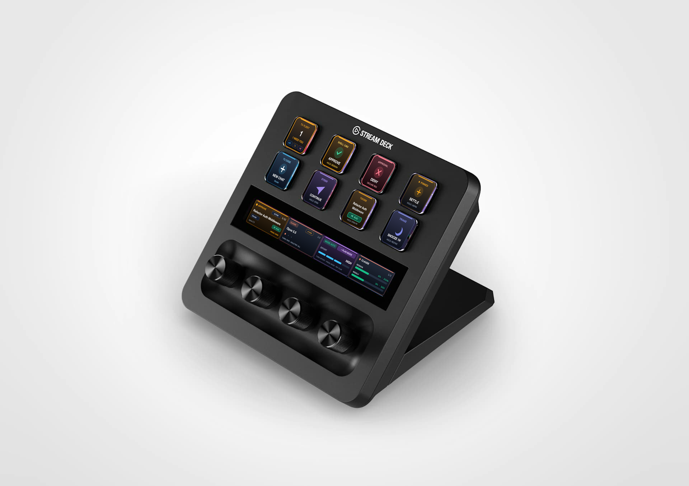

# T3 Deck

**Real-time [T3 Code](https://github.com/pingdotgg/t3code) mission control for Elgato Stream Deck+.**

Speaks directly to your local T3 Code server over its native Orchestration V2 WebSocket RPC stream (`orchestration.subscribeShell` + `subscribeServerConfig`) and `t3code://` deep links — zero extra daemon, zero polling, and sub-50ms live updates across every provider you connect in T3 Code (Claude, Codex, Antigravity, OpenCode, and more).


## Highlights

- **Live active-thread following** — Automatically tracks whichever thread you currently have open in T3 Code (`lastVisitedAt` / `opens.openedAt`). Click into another thread in T3 Code and your entire Stream Deck+ follows it instantly.
- **One-button permission approvals** — Short-press to approve (`accept`), hold to approve for session (`acceptForSession`), or hit **Deny** (`decline`) right from your desk — even for subagent permission requests.
- **Favorites-first multi-provider model picker** — Dial 2 scrubs your T3 Code **★ Favorites** in exact favorite order; hold or tap when idle to toggle the full ready model catalog.
- **Effort, runtime mode, and Plan Mode on one dial** — Turn for reasoning effort (`Low` / `Med` / `High` / `Max`), press for runtime permissions (`Ask` / `Edits` / `Auto` / `Full`), tap the touch strip for **Plan / Code** mode.
- **Multi-provider usage radar** — Live Session & Weekly utilization bars with reset countdowns across every connected T3 Code provider.
- **Native `t3code://` deep links & PR jump** — One press jumps straight to a thread in T3 Code Desktop; hold **Open Thread / PR** to open its linked Pull Request in your browser.



## Mission Control Layout (4×2 Keys + 4 Full-Canvas Dials)

### Keys

| Key | Action | What it shows | Short Press | Hold (650ms) |
|---|---|---|---|---|
| **1** (`0,0`) | **Fleet Pulse** | Live global counts (`▶ running`, `! needs you`, `✕ failed`) | Focus & open highest-priority thread needing you | Reconnect if offline |
| **2** (`1,0`) | **Approve / Answer** | Amber `APPROVE` (shell/file/permission), purple `ANSWER` (`?`), or dim `NO PENDING` | Approve once (`accept`) or open question | Approve for session (`acceptForSession`) |
| **3** (`2,0`) | **Stop / Deny** | Rose `DENY` on approval, red `STOP` when running, or dim `NOT RUNNING` | Decline approval (`decline`) or interrupt active run | Force-stop thread |
| **4** (`3,0`) | **Settle / Pin** | `★ PINNED` header + `SETTLE` / `UNSETTLE` | Toggle Settle / Unsettle | Toggle Pin / Unpin |
| **5** (`0,1`) | **New Chat** | `+` icon + active project name | Open fresh T3 Code composer (`t3code://new`) | — |
| **6** (`1,1`) | **Send / Steer Prompt** | Cyan `SEND` or purple `STEER` + custom label (default `CONTINUE`) | Send/steer prompt (customizable in Property Inspector) | Open focused thread |
| **7** (`2,1`) | **Open Thread / PR** | Project name + 2-line title + green `PR #` badge when linked | Focus thread in T3 Code Desktop | Open linked PR URL in browser |
| **8** (`3,1`) | **Snooze / Sync** | `SNOOZE 1H` / `UNSNOOZE` / `RECONNECT` | Toggle 1-hour snooze | Force full reconnect & resync |

Also includes a bonus **Thread Slot** key action in the **T3 Deck** sidebar category if you want a dedicated wall of direct thread tiles on another page.

### Rotary Dials & LCD Touch Strip

| Dial | Widget | Rotate | Press / Hold | Touch Strip Tap |
|---|---|---|---|---|
| **1** | **Thread Navigator** | Scrub threads in most-recently-visited order | **Press:** Open thread in T3 Code | Cycle filter (`ACTIVE` / `ATTENTION` / `RUNNING` / `PINNED` / `ALL`) |
| **2** | **Model & Provider** | Browse **★ Favs** (or **All** models) | **Press:** Apply when scrubbing, or toggle `★ FAVS ↔ ALL` when idle<br>**Hold:** Toggle `★ FAVS ↔ ALL` | Apply when scrubbing, or toggle `★ FAVS ↔ ALL` when idle |
| **3** | **Mode & Effort** | Adjust reasoning effort level | **Press:** Cycle runtime mode (`ASK` / `EDITS` / `AUTO` / `FULL`) | Toggle **Plan / Code** mode |
| **4** | **Usage Radar** | Cycle connected providers / accounts | **Press:** Refresh live usage limits | Refresh live usage limits |

## Requirements

- **macOS 13+**
- **Elgato Stream Deck 7.1+** (built for **Stream Deck+**)
- **T3 Code** desktop app / local server (`~/.t3/bin/t3` CLI installed — automatic when running T3 Code Desktop)

## Install

### Option 1 — Prebuilt `.streamDeckPlugin` (recommended)

1. Download `com.charlesbine.t3-deck.streamDeckPlugin` from the [Releases](../../releases) page.
2. Double-click it to install into Elgato Stream Deck.
3. Either switch to the bundled **T3 Deck** Stream Deck+ profile, or drag actions from the **T3 Deck** sidebar category onto any page of your existing profile.

### Option 2 — Build & link from source

```sh
git clone https://github.com/metaember/t3-deck.git
cd t3-deck
npm install
npm run typecheck
npm test
npm run build
npm run build:profile
npm run validate
npx streamdeck link com.charlesbine.t3-deck.sdPlugin
```

Restart Stream Deck (or run `npm run pack` to generate `com.charlesbine.t3-deck.streamDeckPlugin`).

## Authentication & Security

- T3 Deck discovers your local T3 Code server from `~/.t3/userdata/server-runtime.json` (respecting `T3CODE_HOME`).
- On first run, it mints a **scoped bearer session** via T3 Code's official CLI:

  ```sh
  t3 auth session issue \
    --scope orchestration:read \
    --scope orchestration:operate \
    --label "T3 Deck (Stream Deck)" \
    --ttl 365d
  ```

- The token is stored locally with `0600` permissions at `~/.config/t3-deck/session.json` and never leaves your machine.
- You can inspect or revoke the session at any time inside T3 Code under **Settings → Sharing & access**.

## Development

```sh
npm run dev       # Rollup watch build directly into com.charlesbine.t3-deck.sdPlugin/bin/plugin.js
npm test          # Unit tests (store, priority triage, favorites, SVG rendering)
npm run smoke     # Live connection smoke test against your local T3 Code server
npm run pack      # Build + bundled profile + Elgato CLI validate + .streamDeckPlugin archive
```

## License

Licensed under the [Apache License, Version 2.0](LICENSE).
